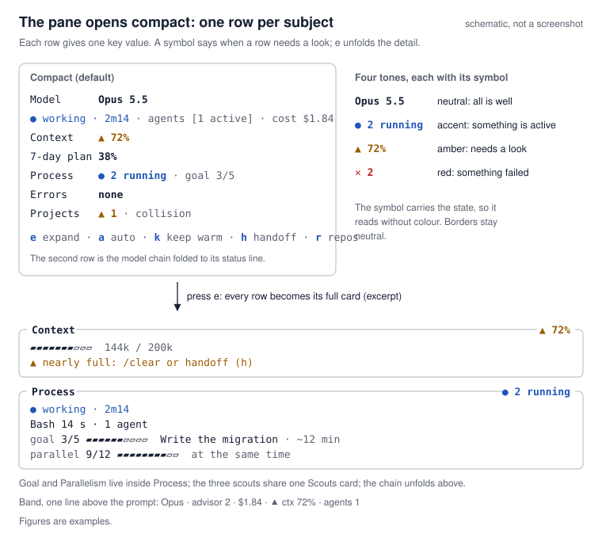
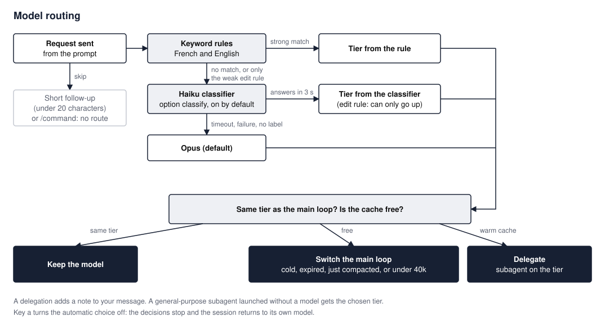
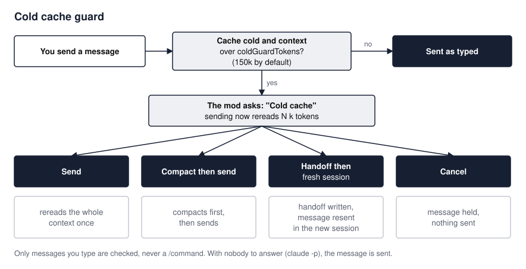
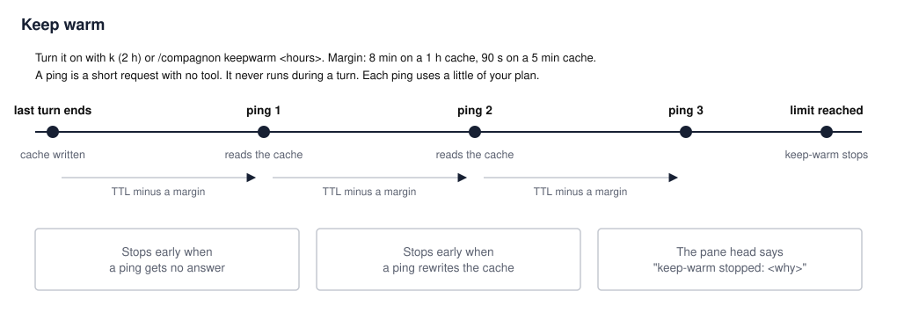
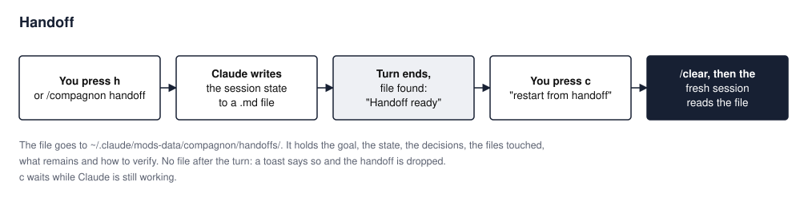
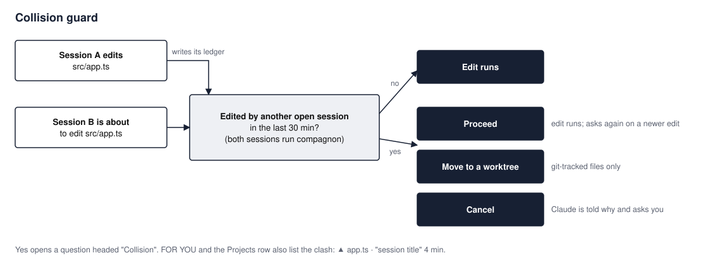
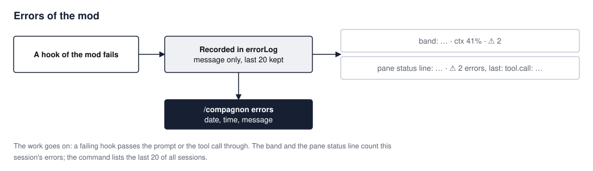

# compagnon

<p align="left"></p>

Built by [Coeurdar](https://coeurdar.com).

A Claude Code mod that opens a side pane with every session, picks the model each request needs without throwing away the prompt cache, and warns you before an action wastes the cache, the context or another session's work.

## What you see



The pane reads by priority, top to bottom: a head, the sections that have something to say, then the cards. It opens **compact** the first time (one grey row per subject) and remembers your last choice (`e`) between sessions.

### The companion and its head

A small artichoke, a nod to the Coeurdar logo, sits at the top left. Its tint says what the session is doing, and it moves only while something moves. Beside it, the head gives:

- the state with its badge and time: `Claude is working · 2m14`, `Waiting for you · 0m38`, `Turn done · 4 s ago`, `Something failed`, `Turn ended: API error` or `Turn ended: refused`, `Interrupted · 3 s ago`, `Resting · idle 12 min`;
- the model routing: the session's model, `→` the tier the last request was routed to, `auto` or `auto off`, then the request's first words and which layer decided;
- the `/goal` progress (`goal 3/5`, the current task, the time left) when there is one;
- the cache: `cache warm 41:08` (and `keep-warm on`), amber with its key when it ends in under 5 minutes (`▲ cache cold in 3:20  k keep warm`), `▲ cache cold · rereads 118k` once cold.

The companion has five moods. The mood is read from the real state, by priority:

| Mood | When | Tint |
| --- | --- | --- |
| Failed | A failed agent or an error of the mod during this turn (or in the last 2 minutes when no turn runs), or a turn that ended in an API error or a refusal. A failure older than that stays listed in `FAILED` but the face follows the rest | red |
| Needs you | A permission prompt is waiting, or a collision question is open (counted from the question, not from the other session's edit). An idle notice is rest, and a collision you answered `Proceed` to waits for no one | amber, the artichoke raises a leaf |
| Works | A turn or an agent is running (a teammate that is idle or pending is not) | blue, it bobs and glances aside |
| Done | A turn ended in an answer less than 20 s ago. An interrupted turn reads `Interrupted` for 20 s, then rests | green |
| Resting | None of the above | grey |

It needs a terminal with 24-bit colour. It is hidden when the pane is narrower than 40 columns (the head's text stays), and the `showCompanion` option turns it off.

### Sections

Each section is drawn only when it is not empty.

| Section | Colour | What it holds |
| --- | --- | --- |
| `FOR YOU` | amber | A permission prompt (answer it in the chat; it clears when the turn ends), a collision with another session, a handoff ready (`c restart`), a cache that is cold or about to be, with `k keep warm`, a context nearly full (`h handoff`) |
| `FAILED` | red | Agents that failed (`view` opens them), the mod's own error of this turn (`/compagnon errors` lists them) |
| `RUNNING` | blue | The running tool and its time, agents with a moving bar and their time (a subagent sits under the agent that spawned it), background tasks (`stop`). Past 2 minutes for a tool, 10 minutes for an agent or a task, a line turns amber with `▲`; an agent waiting or stuck offers `view`. While a permission is waiting, it reads `paused on you` |
| `DONE` | green, then grey | The agents that finished, green for 20 s after the turn, then one grey line |

The API gives no progress for an agent: the bar sweeps back and forth to say it is alive, and the time stands in for a percentage.

### Rows

| Row | Key value | Unfolded with `e` |
| --- | --- | --- |
| `Model` | the main model, `auto`, decisions, advisor calls, session cost | the model chain: `Advisor` (the advisor's calls; its advice is encrypted, so only the call is visible), `Model` (cache countdown, the size Claude would reread if the cache went cold, effort, load), `Decisions` (the tier the last request got and which layer chose it), `Scouts` (the agents named `search`, `grep` and `audit`, one line each; other agents are counted), `Log` (the last things the mod decided), then the status line |
| `Context` | how full the context window is, and the tokens | gauge, tokens, handoff being written |
| `7-day plan` | your weekly plan usage, the 7-day curve and when it resets | the curve and the reset time in a card |
| `Projects` | repositories touched, `+N` followed but untouched, the first one's branch and changes | every repository: branch, changed files, commits ahead or behind, edit collisions, and with `p` the untouched ones |
| `Errors` | the mod's own errors this session, `none` or `✕ 2`, then the last message | the last error message |

Under the rows sits the **keys line**, and above the prompt the **band**: one line with the model, advisor calls, cost, context and running agents. When a permission prompt is waiting, the band says `? waiting for you` in amber in place of the agents; an idle notice does not.

Colours carry one meaning each, and each has its symbol so a state reads without colour:

| Colour | Meaning |
| --- | --- |
| amber, `?` or `▲` | needs you |
| blue, moving | it runs |
| red, `✕` | it failed |
| green `✓`, then grey | done: green for 20 s, then one grey line |
| grey | nothing to do |

The band and `/compagnon errors` count the mod's own errors with `✕`.

When to act:

| You see | Do |
| --- | --- |
| `FOR YOU` with `? permission` | Answer the permission in the chat. |
| `FOR YOU` with `▲ collision`, or `Projects ▲ 1 · collision` | Another open session edited the same file. Coordinate before going on. |
| `FOR YOU` with `● handoff ready` | Press `c` to restart from the handoff. |
| `▲ cache cold in 3:20`, or `FOR YOU` with `▲ cache` | Your next message rereads the whole context. Press `k` to keep it warm, or consider a handoff or a compaction first. |
| `FOR YOU` with `▲ context 74% full`, or `Context ▲ 74%` (70 % or more) | Press `h`, then `c` when the handoff is ready. |
| `FAILED`, `Errors ✕ 2`, or `✕ 2` in the band | `view` opens a failed agent. Run `/compagnon errors` for the mod's own errors. |
| `RUNNING` with a line marked `▲` | `view` opens a stuck agent, `stop` ends a background task. |

## Quick start

In a Claude Code session:

```
/plugin install compagnon --marketplace Johnjohnbei/claude-compagnon
```

Answer `y` to add the marketplace, then choose the scope (user scope means every session).

From a shell:

```
claude plugin install compagnon --marketplace Johnjohnbei/claude-compagnon
```

In the desktop app, where `/plugin` does not run: click `+` next to the prompt, then Plugins, Add marketplace with `Johnjohnbei/claude-compagnon`, then Add plugin.

The repository is public: you only need `git` installed.

The pane opens at session start. If you closed it, run:

```
/compagnon
```

## Workflows

### Model routing



Each request gets a tier: Haiku, Sonnet, Opus or Fable. Keyword rules decide first, in French and English: a request that starts with `where`, `list`, `find` (or `où est`, `liste`) goes to Haiku, `bug` or `crash` to Opus, `architecture` or `root cause` to Fable.
What no rule recognises goes to a Haiku classifier. If it fails or takes more than 3 s, the request stays on Opus.
The mod then switches the main model only when no warm cache is lost. Otherwise it keeps the model and asks Claude to hand the work to a subagent on the right tier.
Model switching needs Claude Code 2.1.309 or later. On an older or unreadable version, the mod always delegates.

### Cold cache guard



When the cache is cold and the context is over the threshold (150k tokens by default, option `coldGuardTokens`), the mod asks before sending.
You choose: send, compact then send, handoff then fresh session (your message is sent again after the restart), or cancel.
With nobody to answer (`claude -p`), the message is sent as typed.

### Keep warm



Use it before a break you know will outlast the cache. Press `k` (2 hours) or run `/compagnon keepwarm 3`.
A ping goes out a little before the cache expires (8 min before on a 1 h cache, 90 s on a 5 min cache), never during a turn.
It stops at the chosen time, when a ping gets no answer, or when a ping rewrites the cache instead of reading it. Each ping uses a little of your plan.

### Handoff



Use it when the context is nearly full or the session drifted. Press `h` or run `/compagnon handoff`.
Claude writes the session state to a Markdown file. When the file is on disk, a toast says `Handoff ready`, `FOR YOU` shows `● handoff ready` and the keys line shows `restart from handoff`.
Press `c`: the session is cleared and the fresh one starts by reading the file.

### Collision guard



Every session running the mod keeps a list of the files it edited.
Before an edit, if another open session edited the same file in the last 30 minutes, the mod asks: `Proceed`, `Move to a worktree` (git-tracked files only) or `Cancel`.
Claude is told why the edit did not run: on `Cancel` it leaves the file alone and asks you how to go on; on `Move to a worktree` it redoes the change in a git worktree.

### Errors



When one of the mod's own hooks fails, your prompt or tool call still goes through, and the failure is recorded.
The band shows `✕ 2`, the pane's `Errors` row shows `✕ 2` and the last message, `FAILED` names the error of the current turn, and unfolded (`e`) the card reads `✕ 2 errors, last: <message>`.
Run `/compagnon errors` to read the list with dates and times.

## Commands

### `/compagnon`

Opens the pane. Use it after closing the pane.

```
/compagnon
```

Reply: `Compagnon pane open.`

### `/compagnon keepwarm [hours|off]`

Keeps the prompt cache warm for the given number of hours (2 when you give none), or stops it. Use it before a break longer than the cache lifetime.

```
/compagnon keepwarm 3
/compagnon keepwarm off
```

Reply: `Cache kept warm for 3 h: one ping before each expiry, stopped if a ping rewrites the cache instead of reading it.` While the cache is kept warm, the head's cache line adds `keep-warm on`.

### `/compagnon handoff`

Asks Claude to write a handoff file. Use it when the context is nearly full or before a fresh start. Same as the `h` key.

```
/compagnon handoff
```

Reply: `Handoff requested: the pane then offers to restart from a fresh session (key c).`

### `/compagnon decisions`

Prints the routing decisions: the count per layer (keywords, classifier, default), then the last 20 with date, layer, tier, action and the first words of the request. Use it to check whether routing suits your requests.

```
/compagnon decisions
```

Reply, for example: `14 decisions: keywords 11, classifier 2, default 1.` followed by one line per decision.

### `/compagnon load`

Prints what the session loads before your first message, source by source: memory files with their path and tokens, skills by plugin, agents, commands, MCP tools by server. It ends with pointers for heavy sources (a memory file of 8k tokens or more, a plugin or MCP server of 1.5k or more). Run it before trimming your setup. `/compagnon charge` is kept as an alias.

```
/compagnon load
```

The reply starts like: `Startup load: 31.2k tokens, plus the conversation 55.0k tokens.`

### `/compagnon errors`

Prints the mod's recorded errors, newest last, with date and time. Use it when the band shows `✕` or the `Errors` row is not `none`.

```
/compagnon errors
```

Reply: `No error recorded.` or `2 errors (last 20 kept, newest last):` followed by one line per error.

## Keys in the panel

| Key | Label | Does |
| --- | --- | --- |
| `e` | `expand` / `collapse` | Unfolds every row into its full card, or folds them back. The pane reopens as you left it: compact the first time, then the last choice is remembered between sessions. |
| `a` | `auto` / `auto off` | Turns automatic model choice off or on. Off returns the main loop to the session's own model. |
| `k` | `keep warm` / `stop warming` | Keeps the cache warm for 2 hours, or stops it. |
| `h` | `handoff` | Asks Claude for a handoff file. |
| `c` | `restart from handoff` | Shown once the handoff is ready, in place of `h`: clears the session and restarts from the file. If Claude is still working, a notice asks you to press `c` again once the turn ends. |
| `r` | `repos` | Reads the followed repositories again. |
| `p` | `others` / `fold` | Shows or hides the followed repositories this session has not touched. Shown only when there are some and the pane is unfolded. |

## Settings

Options declared in `.claude-plugin/plugin.json` (`userConfig`):

| Option | Default | Effect |
| --- | --- | --- |
| `projects` | empty | Absolute paths of the git repositories the `Projects` card follows, separated by `;`. Empty: the session's project only. |
| `showBand` | `true` | The one-line band above the prompt. Off: the pane only. |
| `showCompanion` | `true` | The artichoke beside the pane's head. Off: the head's text only. It is hidden under 40 columns whatever the option. |
| `classify` | `true` | The Haiku classifier for requests the keywords do not recognise. Off: keywords only, the rest stays on Opus. |
| `coldGuardTokens` | `150000` | Context size above which a send on a cold cache asks first. Accepts `150000` or `150k`. `0` turns the guard off. |

## Where data lives

| What | Where |
| --- | --- |
| Automatic choice on or off (`auto`), daily peaks of the 7-day plan (`weekPeaks`), model ids seen per tier (`seenModels`), the last 200 routing decisions (`routeLog`: the first 80 characters of each request, never the full text), the last 20 errors (`errorLog`: the message only) | The engine's plugin store (`$.store`), kept across sessions. |
| Each session's list of edited files, for the collision guard | `~/.claude/mods-data/compagnon/edits/<session>.json` |
| Handoff files | `~/.claude/mods-data/compagnon/handoffs/` |
| The prompt cache itself | Anthropic's side. The mod never saves it. |

The mod API does not expose the cache state: only the status line receives it (`prompt_cache`). For the mod to read it, your status line script must write that field to `claude-ctx-<session_id>.json` in the temporary folder (`TEMP`, else `TMPDIR`, else `/tmp`):

```js
// in your status line script (Node), input = the JSON received on stdin
require('node:fs').writeFileSync(
  require('node:path').join(require('node:os').tmpdir(), `claude-ctx-${input.session_id}.json`),
  JSON.stringify({ prompt_cache: input.prompt_cache ?? null }),
)
```

Without this relay, the mod assumes the cache stays warm for 1 hour after the last turn.

## How the prompt cache works

Claude Code caches the start of the conversation so the next request reads it instead of processing it again. The cache lives 5 minutes or 1 hour after its last use. A cache belongs to one model: switching models starts from zero, and the next request processes the whole context again.

That is why the guards exist. Routing switches the model only when the cache is already cold, just rebuilt by a compaction, or small (under 40k tokens). The cold cache guard asks before a large reread. Keep warm pays for small pings to avoid one large reread.

## Limits

- The pane redraws about twice a second while something is in flight or a permission waits, and not at all at rest.
- Narrow panes (under 44 columns) keep each section row on one line: the name column and the key hints give way, the `view` and `stop` buttons stay.
- The companion needs 24-bit colour, and the mod cannot tell whether the terminal has it: the engine's types expose no colour depth, `NO_COLOR` or theme capability (a search of `.claude-plugin/types/claude-code/index.d.ts` for `colorDepth`, `colorLevel`, `supportsColor`, `NO_COLOR`, `COLORTERM` and `truecolor` finds none). On a terminal without it the faces stay distinguishable by shape (a raised leaf waits, glancing eyes work, a closed smile is done, a wavy mouth fails, half-closed eyes rest), and `showCompanion` turns the drawing off.
- Keyword routing is approximate. The classifier covers what keywords miss; without it (option off, 3 s timeout, failure), the request stays on Opus.
- The plan is published in percentages only. The 7-day curve counts only days when a session ran.
- The collision guard only sees sessions where the mod runs.
- After a keep-warm ping, the status line's cache figures lag behind: the mod trusts the ping until the next expiry.
- The model switch sends the tier name (`haiku`, `sonnet`, `opus`, `fable`) and lets the engine pick the version. No model id is written in the mod.
- Agents show no percentage: the API gives none, so a moving bar and the elapsed time stand in.

### Adding a new model tier

A new family (for example a new name next to Haiku, Sonnet, Opus and Fable) needs two linked edits:

1. Add one row to the `TIERS` table in `hooks/tiers.ts`: its id, display name, default effort and classifier label.
2. Add the same id to the `Tier` union in `types/index.d.ts`. It cannot be derived from the table, because the plugin contract must stay self-contained. A type check fails if the two disagree.

A new version of an existing tier needs no edit: the version is read from the model id the engine returns.

## Development

```
claude plugin validate .
claude plugin test .
```

Typecheck:

```
npx -y -p typescript@5.6.3 tsc -p .
```

No npm dependency: `validate` and `test` come with the CLI. The engine writes its API types and the base `tsconfig.json` to `.claude-plugin/types/` when an interactive session loads the mod from this folder (`claude --plugin-dir .`). That folder is generated and ignored by git.

## Credits and license

Built by [Coeurdar](https://coeurdar.com). The cold cache guard, keep warm and handoff are adapted from Cache Keeper, the collision guard from Collision Guard and the goal line from Goal Meter, all in [inematds/5-mods](https://github.com/inematds/5-mods) (MIT).

The idea of a character that tells you when the agent needs you was inspired by Coucou (MIT). Its code is not used here, and its character and name belong to its author: the artichoke is original, a nod to the Coeurdar logo.

MIT license.
